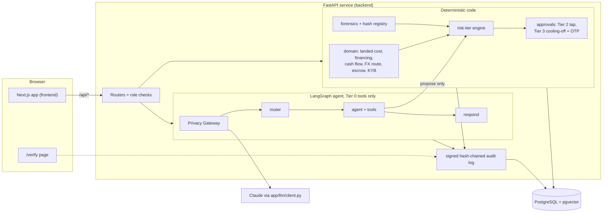
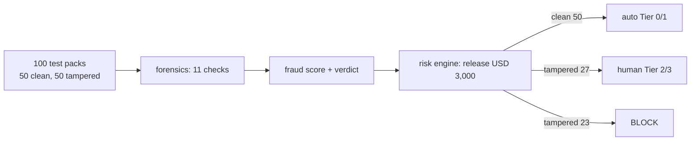

# 1. Overview

Setu is an AI copilot for Bangladeshi SMEs that import from Chinese suppliers. It does five things: it matches
financing options, forecasts cash flow, analyses order cost, checks suppliers and trade documents, and pays
suppliers through milestone escrow with risk-tiered human approval.

**Scope statement.** All transactions are simulated sandbox transactions. There are no payment rails, no real
lenders and no real people. All data is fictional or mock. No machine-learning model was trained or fine-tuned.
Pre-trained Claude models are called through an API to explain results in plain language and to fill missing
document fields. A PayPal **Sandbox** (test-mode) checkout is available as an optional, off-by-default way to
pay into the simulated escrow (section 6.6); it never touches real money.

**Core principle: the LLM explains, code executes.** Every number (cost, margin, gap, FX rate, fraud score, tier)
is produced by deterministic Python. The model may read tool outputs and write words. It cannot call any tool
above Tier 0, so it cannot move money.

Terms used in this document:

- **Landed cost**: the full cost of getting goods to the buyer (goods + freight + insurance + duty + bank charges).
- **Escrow**: money held by a neutral account and released to the supplier in tranches (parts) when conditions are met.
- **KYB** (know your business): checks that a supplier and its bank account are who they claim to be.
- **B/L**: bill of lading, the shipping document. **PI**: proforma invoice.
- **Tier**: how much human approval an action needs (0 none, 3 strictest).
- **OTP**: one-time password.

Requirement IDs (FR-1.., SR-1.., NFR-..) refer to `docs/REQUIREMENTS.md`, the stand-in for the SRS.

# 2. Architecture



(The same diagram with more detail is in `docs/architecture.mmd`. No rendered image was produced; the Mermaid
source is the only form.)

**Components**

| Component | Technology | Responsibility |
|---|---|---|
| Web | Next.js 16 (App Router), TypeScript, Tailwind v4, Recharts | UI in English, Bangla, Chinese (supplier view). Talks only to the API (`/api/*`). Never touches the database. |
| API | FastAPI, Python 3.13 | Routers, session and role checks, services, error format (RFC 7807 problem JSON). |
| Agent and RAG | LangGraph, LangChain, `langchain-anthropic` | Code in `rag_agent/app/agent` and `rag_agent/app/rag`. It runs inside the backend process (`backend/app/__init__.py` adds `rag_agent/app` to the package path). Nodes: load context, privacy gateway, router, agent (tools), respond. Postgres checkpointer. |
| Domain | Pure Python, `Decimal` | Money logic with no LLM and no I/O. |
| Database | PostgreSQL 16 + pgvector; SQLAlchemy 2 + Alembic | One schema owner. Alembic migrations are the only way the schema changes. |
| Models | `claude-haiku-5-5` (router, agent, answers), `claude-sonnet-5-5` (document tasks) | Called only through `backend/app/llm/client.py`. Provider chain, only providers with a key: OpenRouter, then Anthropic direct, then xAI Grok when quota is used up. With no key, an offline mock model. |
| Tracing | LangSmith | Root run holds masked text. Tool runs are traced without raw inputs and outputs. |

**Model-call boundary.** `app/llm/client.py` is the only module that imports `langchain_anthropic` (a test
enforces it). Chat nodes call the Privacy Gateway before every model call. Document extraction
(`structured_call`) also goes through the gateway. Masking is applied in the nodes and in `structured_call`
rather than in one client wrapper (see Limitations).

**Chat turn (LangGraph).** `load_context` → `privacy_gateway` → `router` (fast model, JSON schema, keyword fallback)
→ `agent` ⇄ `tools` (allow-listed per intent, max 6 steps) → `respond`. The agent only gathers facts. The
`respond` node writes the answer from tool results wrapped as untrusted data. Code then appends the simulated-data
note, the injection warning, and a "Why:" line taken from the tool's own explanation fields.

# 3. Data model summary

Single owner: SQLAlchemy models in `backend/app/db/models/` and Alembic migrations (18 revision files in `backend/alembic/versions/`).
Full table list: `docs/data-model.md`. Conventions: money is `NUMERIC(20,4)` with a separate currency code; FX
rates `NUMERIC(20,8)`; enums are `VARCHAR` + CHECK; primary keys are UUIDs (seed rows use `uuid5`).

| Group | Tables (examples) |
|---|---|
| Identity | `parties` (buyer, supplier, lender), `users` (one demo user per role, no passwords), `bank_accounts` |
| Deals and escrow | `deals`, `deal_costs`, `milestones`, `milestone_confirmations`, `escrow_accounts`, `ledger_entries`, `credit_records` |
| Finance | `cashflow_items`, `fx_rates`, `fx_locks`, `financing_options`, `financing_applications`, `alerts`, `supplier_scores` |
| Trust | `party_members`, `onboarding_reviews`, `stepup_challenges`, `kyb_checks`, `kyb_runs`, `documents`, `forensic_findings`, `hash_registry`, `approval_requests`, `approval_events`, `risk_events`, `injection_events`, `privacy_records`, `audit_log` |
| Assistant | `chat_threads`, `chat_messages`, `kb_chunks` (vector(384) + full-text), `llm_cache`, LangGraph checkpoint tables |
| Payments | `sandbox_payments`, `sandbox_payment_events` (PayPal Sandbox records; CHECK `simulated`) |
| Demo | `demo_state`, `demo_sandboxes` (one Postgres schema per judge sandbox), `demo_phone_messages` |

The `audit_log` table has a database trigger that rejects `UPDATE` and `DELETE`.

# 4. Core algorithms

All formulas are in `docs/finance-formulas.md`. The worked example is deal `SETU-2026-0001` (fictional buyer
"Rahima", seed date 2026-10-20).

## 4.1 Landed cost and margin (FR-3) — `backend/app/domain/landed_cost.py`, `margin.py`

```
landed_cost   = goods_value + sum(extra cost lines)       # freight, insurance, duty, bank charges, other
cost_per_unit = landed_cost / quantity
gross_margin  = (revenue - landed_cost) / revenue
price_for_margin(m) = break_even_price / (1 - m)
```

Example: goods USD 9,600.00 + extras 1,600.00 = **USD 11,200.00**; expected revenue 13,660.00; margin **18.01%**.
Duty is one seeded line. A table of duty by HS code (customs tariff code) is not built (see Limitations).

## 4.2 Cash-flow forecast and alerts (FR-2) — `backend/app/domain/cashflow.py`, `alerts.py`

```
closing(d)   = opening(d) + inflows(d) - outflows(d);   opening(d+1) = closing(d)
```

The window is 91 days (today to today + 90). Sources: cash-flow items, unfunded tranches, and deal costs.
Alerts are idempotent (key per party, type, reference, date), auto-resolve when the condition clears and reopen if
it returns. Shortfall alert: first day with closing balance below the buffer; critical if 7 days or less away.
Deadline alerts use a notice window and an action window per type (milestone 30/14 days, duty 60/7, bill of entry
60/7, loan instalment 7/7); critical at one day. FX alert: best day more than 1% below the 30-day mean.
Demo result: shortfall **USD 1,560.00 on 2026-11-07** (balance 4,200.00 against a 5,760.00 milestone).

## 4.3 Financing matching (FR-1) — `backend/app/domain/financing.py`

```
gap (shortfall mode) = min_buffer - closing on the first day below the buffer
gap (order mode)     = max(0, landed_cost - available cash)
total_cost = principal*annual_rate*days/365 + principal*fee_rate + fee_fixed + uplift + flat
EAR        = (1 + total_cost/principal)^(365/days) - 1       # capped at 999,900%
```

Eligibility is a JSON rule tree plus code rules (minimum and maximum amount, tenor fits, insured terms not
offered once escrow is funded). Ranking: eligible first, then lowest total cost, then shorter tenor, then fewer
conditions, then code. Options whose collateral invoice is already pledged elsewhere are blocked by the registry
(section 4.8). Order mode for the demo deal (gap 5,200.00, 45 days): escrow-backed loan 97.70, supplier credit
104.00, bank import loan 173.45, NBFI line 239.34 (before the registry rule; with Lender A holding the invoice,
the escrow-backed Lender B loan is blocked and supplier credit becomes the top pick, see `docs/registry.md`).
Applications are simulated and re-check eligibility at execution.

## 4.4 FX route comparison (FR-7) — `backend/app/domain/fx_route.py`

Compares the cost in BDT of paying via USD (bank USD spread, supplier-side USD→CNY spread, SWIFT and
correspondent fees) against paying in CNY directly (CNY spread, flat fee). Mid rates come from the `fx_rates`
table. **Spreads and fees are mock constants** labelled `MOCK:` in the output. Example: USD 5,760 → USD route
BDT 718,223.24 vs CNY route 712,766.14, saving BDT 5,457.10 (0.76%). The mock rate lock (Tier 2) is
`backend/app/services/fx_lock.py::lock_fx`.

## 4.5 Supplier KYB (FR-4) — `backend/app/domain/kyb.py`

Name normalisation (NFKC, case-fold, suffix canon, CJK map, look-alike folding), then
`score = floor2((token_set_ratio + token_sort_ratio) / 2)` using rapidfuzz. Thresholds: 92 and above PASS, 80 to
92 WARN, below FAIL. Eight checks (licence vs invoice name, licence vs account holder, personal account, account
age under 7 days FAIL or under 30 WARN, account country, pending beneficiary change, registry history, mock
sanctions screen). Score = 100 − sum(weight × severity), FAIL = 1, WARN = 0.5. A sanctions hit forces score 0 and
BLOCKED. Evaluated per bank account.

## 4.6 Milestone escrow (FR-5) — `backend/app/domain/escrow.py`, `backend/app/services/escrow.py`

Schedule `30/60/10` or custom percents (2 to 5 tranches summing to exactly 100); amounts use `split_by_ratios`
with the last tranche absorbing the remainder (9,600.00 → 2,880.00 / 5,760.00 / 960.00). Deal states:
DRAFT → PROPOSED → CONFIRMED → FUNDED → IN_PRODUCTION → SHIPPED → ARRIVED → COMPLETED (+ DISPUTED, CANCELLED).
Escrow states: DRAFT, FUNDED, TRANCHE_RELEASED, COMPLETED, FROZEN, REFUNDED. The ledger is double-entry and each
transaction balances; a database check enforces `funded = released + refunded + balance`.

Release check order (`release_tranche`): milestone READY and evidence VERIFIED → enough balance → beneficiary
ACTIVE and KYB-clean → escrow not frozen and no open Tier 3 request → risk engine → one transaction with row
locks (ledger, balance, milestone, next milestone, deal status, cash-flow, alerts, signed audit row). The same
idempotency key replays the first result; a new key on a released milestone is refused.

On COMPLETED, a credit record is issued and signed with Ed25519 (`backend/app/services/credit_record.py`, FR-8).

## 4.7 Document forensics (FR-6) — `backend/app/forensics/`

1. **Safe upload**: magic-byte file type check, 10 MB cap, sanitised names, storage keyed by SHA-256, signed
   short-lived download URLs. PDF parsing runs in a resource-limited child process.
2. **Extraction**: a deterministic label parser reads the PDF text. A model fills only fields the parser could not
   find, with masked text inside an untrusted wrapper; such a field forces at least WARNING.
3. **Hidden-text detection**: white or near-white text, size 2 pt or less, off-page text, render mode 3, text
   covered by an opaque shape, dark-on-dark (warning only). Hidden text and metadata are reported, never used
   as content.
4. **Cross-checks** (11 names in the ground truth): quantity, value, vessel/date, name, duplicate invoice, price
   band, beneficiary, hidden text, instruction scan, port, HS code.
5. **Fraud score**: sum of weight × factor (FAIL 1, WARN 0.5), capped at 100. Ordinary checks weigh 35;
   beneficiary, hidden text, instruction scan and duplicate hash weigh 70 and force FAILED. Below 30 PASSED,
   30 to 60 WARNING, above 60 FAILED.
6. **Evidence automation**: all required documents PASSED → milestone evidence VERIFIED; WARNING → FLAGGED (buyer
   review); FAILED → REJECTED plus a fraud alert.

## 4.8 Duplicate-financing registry (FR-6, SR-6) — `backend/app/services/hash_registry.py`

Two fingerprints: exact (SHA-256 of file bytes) and semantic (SHA-256 of folded identity fields: seller, invoice
number, total, currency; or shipper, B/L number, vessel for bills of lading). Verdicts over ACTIVE entries:
`NEW`, `SAME_CONTEXT`, `EXACT_DUPLICATE`, `NEAR_DUPLICATE`. A conflict is an active entry in another deal or at
another lender; conflicts win over a same-context entry (fail closed). A duplicate fails the document, raises a
fraud alert and forces Tier 3. `POST /registry/lender-check` lets a lender ask whether a document is already
pledged. The date is deliberately not part of the semantic key. An on-chain anchor is not built: `backend/app/services/registry_anchor.py` holds only a pure Merkle-root helper and an interface, with no network code and nothing wired.

## 4.9 Risk-tier engine (SR-1) — `backend/app/services/risk/engine.py`

A pure function `evaluate(ctx, policy)` returns a decision with reason codes (English and Bangla), a context hash,
a rule trace and counterfactual hints. Thresholds are in `backend/config/risk.yaml`.

| Result | Triggers (examples) |
|---|---|
| BLOCK | sanctions hit, KYB blocked, beneficiary blocked or retired, document FAILED (release) |
| Tier 3 | amount above USD 20,000 (strict), advance above limit, beneficiary change or pending change, beneficiary changed under 30 days ago, fraud score above 60, duplicate hash, instruction from a document, KYB account warning |
| Tier 2 | first deal with the supplier, document WARNING, FX rate not locked, not fully verified (fail closed), lock FX, confirm or propose milestones, agent origin |
| Tier 1 | none fired: executes and raises an information alert |
| Tier 0 | non-money analysis |

The highest tier wins; BLOCK beats every tier. Enforcement points inside services: `release_tranche`,
`fund_escrow`, `propose_milestones`, `confirm_milestones`, `lock_fx`, `change_beneficiary`.

# 5. LLM explains, code executes

- Tool registry (`rag_agent/app/agent/registry.py`): each tool has a `max_tier`. `guard()` refuses any tool above
  `MAX_LLM_TOOL_TIER` (Tier 0, in `backend/app/security/tiers.py`) before validation. The model is only offered
  allow-listed tools at or below the ceiling. Money tools (`propose_*`) are Tier 0 and only create a pending
  request.
- A model that names a tool such as `apply_financing` or `release_tranche` gets `unknown_tool` or
  `requires_approval_flow`.
- Executing an approved action happens in a human HTTP endpoint (`POST /approvals/{id}/approve`), whose body is
  `{otp?}` only. The service re-runs the risk engine on fresh facts and re-checks the binding hash, tier,
  parameters and cooling-off.
- The "Why:" line of an answer is taken from the tool's explanation fields by code if the model omits it.
- Money is `Decimal` in Python and `NUMERIC` in the database. Floats are rejected at API boundaries.

# 6. Security design

Details and code references: `docs/submission/SECURITY_SELF_ASSESSMENT.md`.

## 6.1 Human approval

Lifecycle: `PENDING → APPROVED → EXECUTED`, or `REJECTED | CANCELLED | EXPIRED | LOCKED`. Only the deal's buyer
or an admin decides. Tier 2 is one tap. Tier 3 has a cooling-off pause (600 s by default; `cooling_off_until()` never
returns less than 600 s when `APP_ENV=prod`; 30 s in demos), then a 6-digit OTP (HMAC-SHA256, 5-minute life, three
wrong codes lock the request). Where the code goes depends on `AUTH_MODE`:

- `demo` (judge deployment): a simulated SMS panel that exists only when `DEMO_MODE=true` and `APP_ENV` is not `prod`.
- `neon` (real accounts): the code is e-mailed to the buyer party's active OWNER and FINANCE members. It never
  appears in an API response, audit payload or log. A four-eyes rule (`FOUR_EYES_ENFORCE`) stops the person who
  created a request from approving it when another approver exists; an e-mail step-up (`backend/app/services/stepup.py`)
  guards admin decisions and Tier 2 approvals. This proves control of a mailbox, not possession of a device.

If the tier is higher at execution time the old request is cancelled and a stricter one is opened. Requests expire
after 24 hours. Details: `docs/auth.md`, `docs/approvals.md`.

Beneficiary (payout account) changes are accepted only in-app through the supplier portal. An e-mail asking to
pay another account is blocked, raises a fraud alert and writes a signed audit row.

## 6.2 Prompt-injection defence (SR-3)

Text from documents, e-mail, knowledge-base passages and tool results is data, never instructions.

| Layer | What it does |
|---|---|
| 1 Structural separation | Untrusted text is wrapped with a random boundary after masking; fixed rule in the system prompt. |
| 2 Detection | Normalises (NFKC, look-alikes, zero-width, spaced letters, base64/URL decode), then English/Bangla/Chinese rules; score 0 to 100, flagged at 50 or more. |
| 3 Capability control | Always on. A detection linked to a deal makes that deal's next money action Tier 3. |
| 4 Tool gating | Money tools need the right intent, the user's own words, and no detection in the turn. |
| 5 Output guard | Removes claims that a payment happened, system-prompt leaks and echoed instructions. |
| 6 Switch | `INJECTION_DEFENCES=on|off` for layers 2, 4, 5 only (ignored when `APP_ENV=prod`). |

## 6.3 Privacy Gateway (SR-4)

Detectors for NID, passport, phone (Bangladesh, China), account numbers, IBAN (mod-97 check), SWIFT, e-mail,
known and labelled names, and amounts. Values become per-request reversible tokens such as `⟦ACCT_1⟧`. The vault
is in memory only and cannot be pickled. The gateway re-scans the outgoing payload and blocks the call if an
identifier survives. Graph state and the checkpoint hold masked text; the runner restores values in the answer
shown to the user. Because amounts are masked, the model cannot compare them; numbers come from tools.

## 6.4 Signed audit log (SR-5), scheme `setu-audit-v2`

```
payload_hash = sha256(canonical_json(body))     # body = seq, ts, actor_type, actor_id, deal_id, action, tier, decision, payload
entry_hash   = sha256(prev_hash | payload_hash | seq | ts)
signature    = Ed25519(private_key, entry_hash bytes)         # genesis prev_hash = 64 zeros
```

A transaction-scoped advisory lock gives a strict sequence. Payloads are PII-redacted before signing (amounts
kept). With no signing key, no row is written. A trigger blocks UPDATE and DELETE. Verification needs only the
public key (`docs/submission/audit-public-key.pem`): CLI `pnpm audit:verify`, browser `/verify` (Web Crypto, no
upload), API `GET /api/audit/verify`. A tamper demo edits an in-memory copy and shows the chain failing.

## 6.5 Other controls

Secrets only in environment variables (never logged or sent to the model). Two authentication modes
(`AUTH_MODE`, `docs/auth.md`): `demo` is an HMAC-signed "login as" cookie for the judge deployment; `neon` verifies a
Neon Auth EdDSA JWT (JWKS, issuer, audience, expiry), requires a verified e-mail, an onboarded account and `ACTIVE`
status, and is mandatory when `APP_ENV=prod`. In neon mode a new company goes through self-service onboarding with
automatic KYB checks and an admin review queue before it can use deals. In production the app refuses to start unless
the secrets are 32+ characters, the cookie is secure, the origin list is exact and demo features are off
(`check_prod_settings` in `backend/app/main.py`). Judges get isolated sandboxes (one Postgres schema each, 4-hour TTL,
rate limits, live-AI budget).

## 6.6 PayPal Sandbox checkout (optional, simulated)

`backend/app/api/payments.py`, `backend/app/services/payments/`, reference `docs/paypal-sandbox.md`. Off unless
`PAYPAL_SANDBOX_ENABLED=true`. The server derives the amount (next unpaid tranche or remaining goods value); the
request body carries no amount. A captured Sandbox payment is a separate record. It funds the simulated escrow only
when the buyer asks, through the normal risk gate (`escrow.fund_escrow`): a BLOCK leaves the payment unlinked, and a
Tier 2/3 result creates an approval and moves nothing. Webhooks are signature-verified, de-duplicated by event id,
and never post to the ledger. Every step is written to the audit log (`PAYMENT_*` actions). The API host is fixed to
`api-m.sandbox.paypal.com`, so real PayPal cannot be reached by configuration.

# 7. Knowledge base and citations

Seven sources in `rag_agent/kb/sources/` written by the team (about 3,900 words plus a generated financing catalogue), 59 chunks. Local
multilingual embeddings (`sentence-transformers/paraphrase-multilingual-MiniLM-L12-v2`, 384 dimensions, via
fastembed). Retrieval merges vector top-20 and full-text top-20 with reciprocal rank fusion (k = 60) and returns 4
passages. Every passage passes the injection detector; flagged passages are withheld. Answers cite `[S1]`.
Bangladesh Bank figures are simplified summaries and not independently verified.


# 8. Evaluation

**All figures in this section are measured on synthetic data. They are ceilings, not real-world accuracy.** No
model was trained; the harness measures the deterministic checks and defences.

## 8.1 Method

- **Data.** A synthetic generator (`backend/synthetic/`, seed 42) makes 100 clean and 100 tampered trade-document
  packs (10 fraud types, obvious and subtle; 6 PDFs per pack), split 100 dev / 100 test, stratified. A 25-item
  injection attack set (5 styles) is split 13 dev / 12 test. Thresholds and patterns were tuned on the **dev split
  only**. The numbers below are from the **test split**, run by the harness `backend/eval/run.py`.
- **Command.** `uv run --directory backend python -m eval.run --split test` (needs `data/generated` and, for the
  duplicate-registry part, a database; `make eval` calls the same module). Output: `backend/eval/results/metrics.json`
  and `metrics.md`, plus `injection_test.json`. Generated 2026-10-20T14:43:49+00:00 (UTC) for the figures below.
- **No LLM extraction was used** in this run: fields come from the deterministic parser. Model fallback (section 4.7)
  is not measured here.
- **Definition of "flagged".** A check flags when it returns WARN or FAIL. A "FAIL only" view is also reported.

## 8.2 Test-split results

| Area | Measured result (test split, synthetic) |
|---|---|
| Fraud detection, 11 checks, WARN or FAIL = flagged | precision 1.0, recall 1.0, F1 1.0; all 10 fraud types recall 1.0 (5 to 7 packs each) |
| Fraud detection, FAIL only | precision 1.0, recall 0.9508, F1 0.9748. Three subtle NAME_MISMATCH packs (PACK-0075, -0099, -0115) are WARN, not FAIL, by design; NAME_MISMATCH FAIL-only recall is 0.4 (2 of 5) |
| Clean packs flagged | 0 / 50 |
| Tampered packs with at least one unpassed document | 50 / 50 |
| Duplicate-document catch rate | 5 / 5 (exact 2/2, near-duplicate 3/3) |
| Prompt-injection attack success, 12 attacks | defences off 100%, on 0%, on without the detector 0% |
| Injection detection | recall 100%; false positives 0 / 300 clean documents |
| Money moved by any injection attack | 0 in all three modes |
| PII to the model, 100 packs, 600 documents | ground-truth identifiers leaked: masking off 600 / 600, on 0 / 600; detector-found identifiers in payload: off 2,491, on 0; extracted-field accuracy 1200 / 1200 in both modes |
| Risk-tier decision, USD 3,000 release per pack | clean packs: 50 auto (Tier 0/1), 0 escalated, 0 blocked. Tampered packs: 0 auto, 27 escalated (Tier 2/3), 23 blocked. False-escalation rate on clean packs 0.0; tampered packs auto-released 0 |



**Injection per style** (test, all modes n = 12): hidden white text 2, tiny-font footer 3, visible notes 2, PDF
metadata 3, non-English 2. With defences off every style succeeded. With defences on, the detector caught 12 of 12
(all at layer 2). With the detector removed, the other layers (capability control, tool gating, output guard) still stopped all 10
attempted forbidden tool calls before they reached a service (`reached_services` 0). The harness does not say which
of those layers did it.

## 8.3 What the numbers do and do not show

- The data is synthetic. The generator and the checks were built by the same team, so perfect scores are a ceiling.
  Dev and test agree (both 1.0 for flagged), which suggests the checks were not tuned to a few packs, but it does not
  show real-world accuracy.
- The injection harness drives the real graph nodes with an **obedient mock model** that ignores delimiters. It
  tests detection, capability control, tool gating and the output guard. It does **not** show that layer 1
  (structural wrapping) binds a real model. "Money moved 0" holds in the off mode too, because money can only move
  through a human endpoint; the metric that differs is whether a forbidden tool call was attempted and reached a service.
- The risk-tier row evaluates one scenario (a USD 3,000 release with otherwise clean context). It shows how forensic
  results flow into tiers, not the whole policy.
- Real-model answer quality was checked by hand on 12 English and Bangla questions through OpenRouter, not at scale.
- Photo-versus-spec checking is colour only; width needs OCR or a vision model (off).

## 8.4 Software tests

Last recorded runs in `docs/PROGRESS.md` (earlier phases; not re-run for this document): pytest 1,313 passed with
23 registry tests failing when no migrated database is available (P23); Vitest 433 passed (P23); guided demo replay
27 of 27 scenes offline (`pnpm run demo:check`, P21). Tests live in `backend/tests/` (includes `agent/` and `rag/`)
and `frontend/src/**/*.test.*`, with Playwright specs in `frontend/e2e/`. Reference: `SUBMISSION_CHECKLIST.md`.

# 9. Deployment

- **Local:** Docker for PostgreSQL + pgvector; `pnpm run dev` runs the API (:8000) and web (:3000). A `full` Docker
  Compose profile builds both apps: `docker compose --env-file docker-compose.env.example --profile full up --build`
  (`backend/Dockerfile`, `frontend/Dockerfile`; a clean-machine run is not recorded).
- **Hosted:** `vercel.json` defines two Vercel services (`web` from `frontend`, `agent` from `backend`) with `/api/*`
  routed to the agent; Neon PostgreSQL with pgvector. A VPS shape (`docker-compose.prod.yml`, Caddy) is also provided.
  Steps and variable names: `docs/deploy-prod.md`. Smoke test: `scripts/smoke_prod`.
- **Required production settings:** see `docs/deploy-prod.md` section 1 (names only). Key ones: `APP_ENV`,
  `AUTH_MODE`, `DEMO_SESSION_SECRET`, `OTP_SECRET_SEED`, `DOCUMENT_URL_SECRET`, `ALLOWED_ORIGINS`, `DATABASE_URL`,
  `AUDIT_SIGNING_KEY` (matching the committed public key), and a model key. With no key the app runs in offline mock
  mode.
- **Judge deployment note:** `APP_ENV=prod` requires `AUTH_MODE=neon` and `DEMO_MODE=false`, which switches off the
  simulated SMS panel and the scam simulator that the guided demo uses. A judge-facing deployment therefore runs with
  `APP_ENV=dev`, `AUTH_MODE=demo`, `DEMO_MODE=true` (`docs/deploy-prod.md` section 0). [TO FILL: confirm what the
  submitted deployment actually uses.]
- **Nothing is recorded as deployed** in `docs/PROGRESS.md` (P23). **Live URL:** [TO FILL]. **Status page:** [TO FILL].

# 10. Limitations and future work

See the known-risk list in `SECURITY_SELF_ASSESSMENT.md`. Main items:

- Evaluation is synthetic only; real documents, real model extraction and a real model against the injection set are
  not measured.
- Authentication: `neon` mode exists, but the judge deployment uses the demo login. E-mail step-up is not a device factor.
  There is no SMS provider.
- The PayPal Sandbox checkout is test-mode and optional; no live payment rail, lender or bank is connected.
- HS-code duty table not built (duty is one seeded line); financing repayments and a loan-repayment flow for the
  registry are not built; no on-chain registry anchor.
- Bangla and Chinese text not reviewed by native speakers; `/app` mobile Lighthouse performance about 77 (target 85).

# 11. Third-party components

See the README section "Third-party licences". Fonts: Inter and Noto (SIL OFL 1.1). Icons are self-made. The
embedding model is `sentence-transformers/paraphrase-multilingual-MiniLM-L12-v2`. PayPal Sandbox is a third-party test
service used under PayPal's developer terms.
